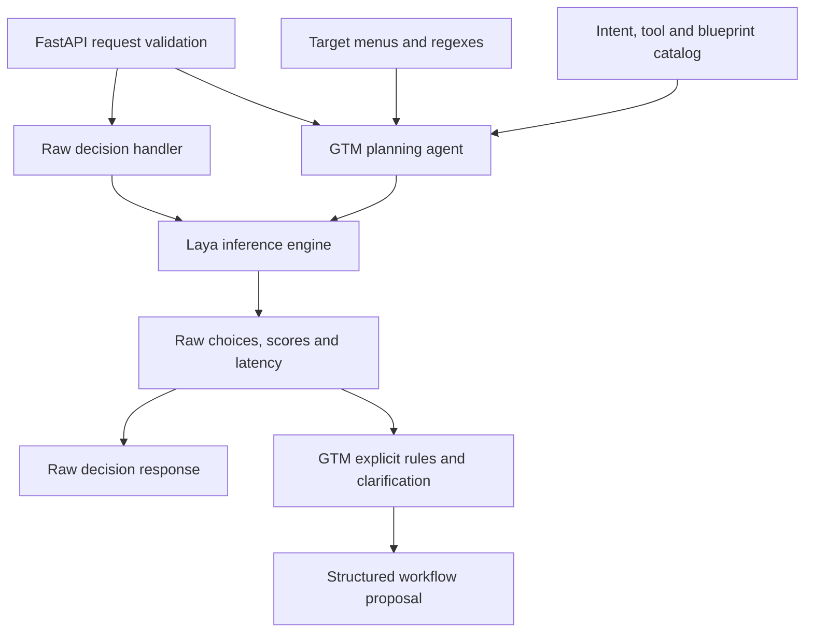
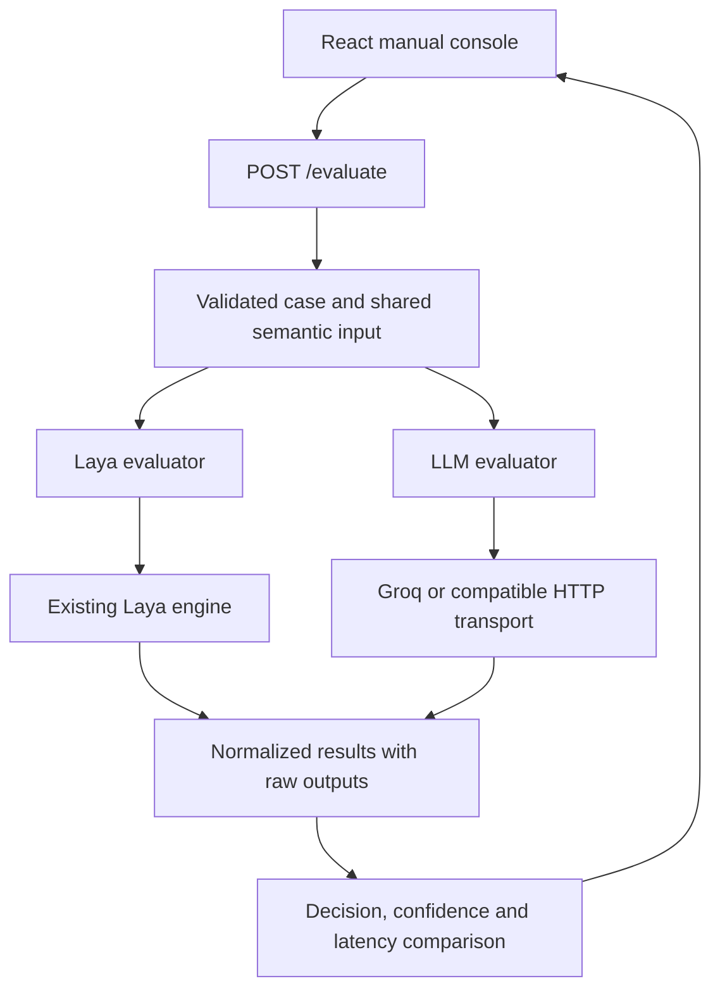

# Current architecture and evaluation platform

Existing service: local PyTorch Laya, API 1.1.0, existing `typed-decisions`
default. Deleted tests, SVG, preparation tools and generated datasets were not
recovered. The runtime behavior of existing components is preserved.

## Current flow



| Component | Implemented responsibility |
| --- | --- |
| app/main.py | Application construction, original logging/CORS configuration, route registration and startup warmup |
| app/api/health.py | Existing GET /health transport |
| app/api/decision.py | Existing POST /decision transport and error responses |
| app/api/planning.py | Existing POST /agent/plan transport and error responses |
| engines/laya_engine.py | Router singleton, warmup, inference, score parsing and timing |
| agents/gtm_agent.py | Four classification questions, explicit rules, uncertainty checks and plan assembly |
| models/decision.py | Existing raw-choice contracts and shared decision provenance |
| models/planning.py | Existing GTM contracts; not lead-scoring contracts |
| models/health.py | Existing readiness response |
| taxonomy/ | Role, industry and geography choices/patterns |
| workflows/catalog.py | Authored GTM intents, tool descriptions and fixed workflow templates |
| scripts/ | Existing developer demo and manual Router probe |

The engine owns prediction only. It still prefers winning-option probability,
then `answer_confidence`, then legacy `confidence`, otherwise null. Rounding is
unchanged. The agent calls the engine before its rules, preserves original
answers in `model_predictions`, and applies the existing 0.5 intent threshold
when no explicit intent rule matched. Recognized unsupported or multiple scope
categories require clarification. A missing blueprint returns `unsupported`.

| Intent | Existing action sequence |
| --- | --- |
| account_discovery | discover_companies |
| contact_hunting | find_decision_makers; verify_contact_data when requested |
| outbound_pipeline | discover_companies, find_decision_makers, verify_contact_data, qualify_leads |
| enrichment_only | enrich_records |
| crm_cleanup | verify_contact_data |
| inbound_triage | classify_incoming_replies |

Tool selection is fixed by the blueprint. `smart_lead_scoring` is a proposed
tool label; there is no scorer. `campaign_sequencer` remains unused. Python
templates supply reasoning text. No searches, contact verification, campaigns
or CRM mutations are executed.

## Dependencies and compatibility

```text
app/main -> app/api -> engines or agents -> models
agents -> engines, models, taxonomy categories, workflows/catalog
engines -> Laya, models/decision
models/planning -> models/decision
scripts -> agents/models, or Laya directly for the manual probe
```

Canonical implementations do not import root compatibility wrappers.
`engine.py` and `gtm_agent.py` alias the canonical modules so old/new imports
share state. `contracts.py` re-exports the same classes. The `taxonomy` package
re-exports all original names, including workflow names for compatibility;
new code imports those from `workflows.catalog`.

The `app` package exports the application, lifecycle and original endpoint
functions. `uvicorn app:app` and `uvicorn app.main:app` use the same object.
Root app/demo/probe launchers retain the original commands. HTTP URLs, route
order, metadata, schemas and handler bodies are preserved.

## Implemented manual evaluation flow



`models/evaluation.py` owns contracts; `evaluators/base.py` prepares a common
input and fingerprint; `evaluators/service.py` runs both adapters concurrently.
The Laya adapter uses a worker thread and a lock scoped to manual evaluations.
Legacy routes do not share this lock. The LLM transport handles HTTP and the
LLM evaluator handles schema validation and normalization. `core/config.py`
reads backend-only configuration without mutating legacy process settings.

An optional raw-output callback was added to the existing engine. Its default
return shape, parsing, confidence policy and inference behavior are unchanged.
Manual evaluation bypasses the planner: no regex corrections, workflow
execution or lead-score aggregation occur. LLM confidence is self-reported;
evidence is unverified. See docs/MANUAL_EVALUATION.md for metric definitions.

Future work requires separately approved lead/ICP contracts, structured checks,
evidence validation, reviewed evaluation labels, calibration and deterministic
score aggregation. None is implemented by the manual comparison route.

## Data and historical assets

Reference observations and the mixed company/synthetic-contact pool are in
`datasets/reference/`. Existing labelled task fixtures are in
`datasets/benchmark/legacy/`. This classifies data, not implemented benchmark
functionality. Labels have not been newly adjudicated. See datasets/README.md.
The original PNG is retained as `docs/architecture-legacy.png`; its deleted SVG
was not restored. Written diagrams and the project map describe current paths.

## Design limitations preserved for a later phase

- Accepted context is unused; exact filters and exclusions lack a typed contract.
- Regexes can mishandle negation and employee-count requests; categories lose
  exact scope and cannot represent many requested targets.
- Outbound plans include a scoring label without an enforced ICP requirement.
- Model result IDs/choices/probabilities are not comprehensively validated.
- Synchronous inference runs in async handlers, without a bounded queue,
  inference lock or execution cancellation.
- Wildcard CORS, unauthenticated routes and exception-detail responses remain.
- Most dependency versions are lower bounds rather than a complete lock.
- Historical fixture labels and responses are not fresh accuracy evidence.

These issues were documented without changing behavior. Automated tests are
deferred under the current instruction; the deleted suite was not recovered.
Structural verification is not a model-quality or production-readiness test.

Benchmark execution, scoring, evidence verification, confidence calibration,
databases, Redis/Celery, authentication, multi-tenancy, Docker and deployment
remain outside the manual evaluation phase.
