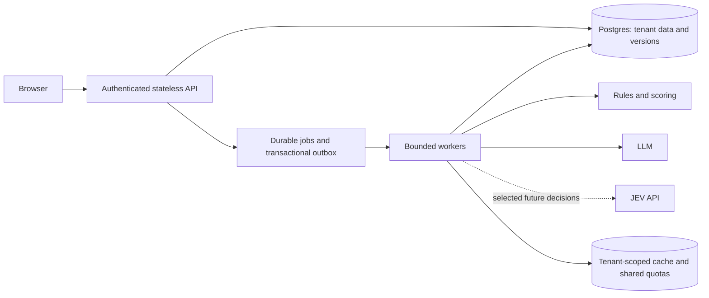

# Production direction and ordered changes

Updated 17 October 2026. The user chose this working folder, official TypeSafe JEV for future selected decisions, and a target of **1,000–10,000 simultaneous users**. Current instruction: **clean up first, retain the LLM workflow, do no testing/benchmarks now, then identify JEV replacements later**. The JEV key already exists in `.env` and is left untouched.

## Where we are

FastAPI and React/Vite provide local discovery, saved audiences, LLM batch scoring and a separate criterion-scoring API. SQLite stores runs; in-process background tasks have two scoring-run slots. Decision Lab previously imported Laya even though Laya was absent from declared requirements.

The cleanup removes that import path, makes Decision Lab LLM-only, archives the retired planner/runtime and unused comparison UI, and clarifies folder/document ownership. Lead discovery/scoring and datasets remain in place. No JEV adapter is added in this revision.

These are source changes, not evidence of runtime success or capacity. The local singleton implementation serialized Laya inference; we have not established that Laya universally cannot scale. Hosted JEV moves inference outside this service but still has account quotas and does not solve database/job bottlenecks.

## Where JEV may fit later

| Current code | Responsibility | Future decision |
|---|---|---|
| `evaluators/service.py` | Explicit bounded category decisions | Natural first JEV candidate after understanding the LLM baseline |
| `scoring/people_search.py` | Free-form filter/title extraction | Keep LLM generation; code validates and retrieves |
| `scoring/llm.py`, `scoring/service.py` | Semantic criterion judgments | Candidate: match/partial/miss/unknown for a specific requirement |
| `scoring/catalog.py`, `scoring/policy.py` | Rules, score arithmetic, gates and recommendations | Keep deterministic code |
| `scoring/batch.py` | Current LLM-selected IDs and numeric scores | Retain as baseline; replace only through an explicit criterion design |
| `scoring/explanations.py`, profile drafting | Text generation | Keep LLM or factual templates |

JEV uses typed decisions rather than free-form generation. Its Choice output does not supply the quotations required by the current semantic scorer, so future integration must preserve evidence attribution separately. Do not substitute JEV's numeric output for our final fit/intent arithmetic. [Official API](https://docs.typesafe.ai/api)

## Production target

Jobs pin tenant, stable lead IDs, facts, profile/policy/model versions. APIs return job IDs promptly; workers need leases, idempotent writes, bounded retries and recovery. An outbox prevents lost dispatch. Tenant scope must be enforced by the server for records, cache keys and traces.

Provider quotas must be shared across workers. Track job queue age, failures, latency, cost, fallback and unknown rates; restrict access to prompt/PII traces. Cache only equivalent inputs, including tenant, offering/persona and evidence/model versions.

## Capacity meaning

`provider calls/second = active users × jobs per user per second × model calls per job`

Illustration only: 10,000 users submitting one job per minute, five calls/job, means approximately 833 calls/second before caching/retries. Actual lead batch sizes, token volumes, burst duration and latency targets still need definition. Simultaneous sessions are not simultaneous inference calls.

TypeSafe sets request/token limits per organization; use the account's actual limits when planning. [Official limits](https://docs.typesafe.ai/models) No capacity benchmark is run in this phase. The current app must remain single-process until durable jobs replace startup recovery and in-process tasks; adding workers now can interrupt each other's run state.

## Step-by-step order

| Phase | Result | Status |
|---|---|---|
| 1. Cleanup | LLM-only runtime, archived Laya files, clear docs and backups | Source changes prepared; execution deliberately not checked |
| 2. Understand the LLM baseline | User-led scenarios, explicit inputs/outcomes and decision boundaries | Later, when the user requests testing |
| 3. Production foundations | Authenticated tenants, Postgres/migrations, stable IDs, persisted profiles/evaluations, durable jobs, quotas | Design recorded; implementation pending |
| 4. Selected JEV integration | One bounded decision behind a common adapter; retain LLM/rule paths | Not activated |
| 5. Validation and rollout | Comparable quality/cost/latency evidence, failure recovery, capacity checks, shadow rollout | Deferred; separate user authorization to resume tests |

Neither cleanup nor an API key establishes production readiness. Preserve public scoring behavior while introducing the infrastructure in small steps. Production integration remains separate from modifying this standalone project.

## Cleanup decisions

Retain the active API, schemas, scoring/UI files, synthetic datasets and dependency manifests. Preserve ignored `venv/` as local tooling and `data/` as runtime records. Archive the retired Laya engine/evaluator, unmounted planner routes, their catalogs/demo scripts, and unused ScorePanel/comparison components. Keep reversible originals under `.backups/`; never treat `.env` or stored runs as clutter.
