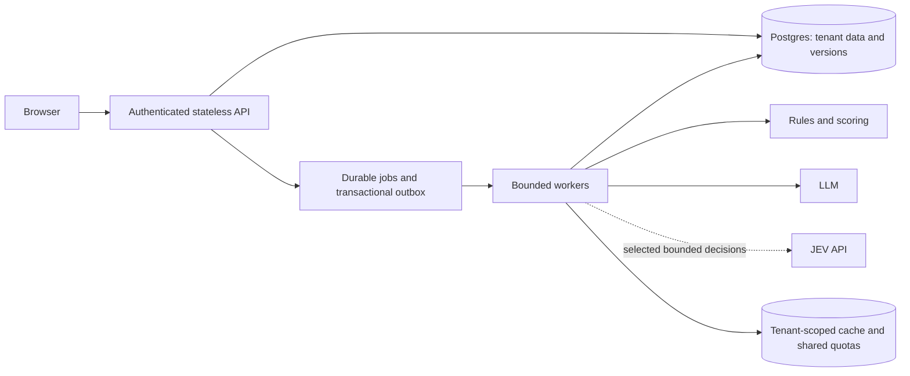

# Production direction and ordered changes

Updated 21 October 2026. The user chose this working folder, official TypeSafe JEV for future selected decisions, and a target of **1,000–10,000 simultaneous users**. Instruction of 17 October: **clean up first, retain the LLM workflow, do no testing/benchmarks now, then identify JEV replacements later**. The JEV key already exists in `.env` and is left untouched.

Since that instruction, a JEV path was added for one decision, lead filter-and-score, and compared with the LLM on 19 October (see [Current JEV evidence](#current-jev-evidence)). DeepSeek remains the default; JEV is opt-in per run and not yet an approved replacement.

## Where we are

FastAPI and React/Vite provide local discovery, saved audiences, LLM batch scoring and a separate criterion-scoring API. SQLite stores runs; in-process background tasks have two scoring-run slots. Decision Lab previously imported Laya even though Laya was absent from declared requirements.

The cleanup removes that import path, makes Decision Lab LLM-only, archives the retired planner/runtime and unused comparison UI, and clarifies folder/document ownership. Lead discovery/scoring and datasets remain in place. A later revision (commit `24202c2`) added the JEV transport (`engines/jev_engine.py`) and a JEV path for lead scoring (`scoring/jev_scoring.py`), selected per run with `decision_model`.

These are source changes, not evidence of runtime success or capacity. The local singleton implementation serialized Laya inference; we have not established that Laya universally cannot scale. Hosted JEV moves inference outside this service but still has account quotas and does not solve database/job bottlenecks.

## Where JEV fits

| Current code | Responsibility | JEV status |
|---|---|---|
| `scoring/batch.py` + `scoring/jev_scoring.py` | Lead filter-and-score | **Prototype built and compared on one target.** LLM path is the default baseline; JEV path is opt-in per run |
| `evaluators/service.py` | Explicit bounded category decisions | Candidate; not built |
| `scoring/people_search.py` | Free-form filter/title extraction | Keep LLM generation; code validates and retrieves |
| `scoring/llm.py`, `scoring/service.py` | Semantic criterion judgments | Candidate: match/partial/miss/unknown for a specific requirement |
| `scoring/catalog.py`, `scoring/policy.py` | Rules, score arithmetic, gates and recommendations | Keep deterministic code |
| `scoring/explanations.py`, profile drafting | Text generation | Keep LLM or factual templates |

The JEV lead path follows the intended split: **code writes the questions, JEV answers with probabilities, code decides.** `build_questions` creates one yes/no question per filter the target uses (role, location, excluded location, department, seniority, experience) plus a 4-level fit rating. `decide` requires every gate to reach `JEV_MATCH_THRESHOLD`, computes the 0–100 score from the fit answer, and records the weakest requirement. JEV never sees the threshold.

JEV uses typed decisions rather than free-form generation. Its Choice output does not supply the quotations required by the current semantic scorer, so future integration must preserve evidence attribution separately. Do not substitute JEV's numeric output for our final fit/intent arithmetic. [Official API](https://docs.typesafe.ai/api)

## Production target

Jobs pin tenant, stable lead IDs, facts, profile/policy/model versions. APIs return job IDs promptly; workers need leases, idempotent writes, bounded retries and recovery. An outbox prevents lost dispatch. Tenant scope must be enforced by the server for records, cache keys and traces.

Provider quotas must be shared across workers. Track job queue age, failures, latency, cost, fallback and unknown rates; restrict access to prompt/PII traces. Cache only equivalent inputs, including tenant, offering/persona and evidence/model versions.

## Capacity meaning

`provider calls/second = active users × jobs per user per second × model calls per job`

Illustration only: 10,000 users submitting one job per minute, five calls/job, means approximately 833 calls/second before caching/retries. Actual lead batch sizes, token volumes, burst duration and latency targets still need definition. Simultaneous sessions are not simultaneous inference calls.

TypeSafe sets request/token limits per organization; use the account's actual limits when planning. [Official limits](https://docs.typesafe.ai/models) No capacity benchmark is run in this phase. The current app must remain single-process until durable jobs replace startup recovery and in-process tasks; adding workers now can interrupt each other's run state.

## Step-by-step order

| Phase | Result | Status |
|---|---|---|
| 1. Cleanup | LLM-only runtime, archived Laya files, clear docs and backups | Source changes prepared; execution deliberately not checked |
| 2. Understand the LLM baseline | User-led scenarios, explicit inputs/outcomes and decision boundaries | Later, when the user requests testing |
| 3. Production foundations | Authenticated tenants, Postgres/migrations, stable IDs, persisted profiles/evaluations, durable jobs, quotas | Design recorded; implementation pending |
| 4. Selected JEV integration | One bounded decision behind a common adapter; retain LLM/rule paths | Lead filter-and-score prototype built, opt-in per run; first comparison done on one target; not the default |
| 5. Validation and rollout | Comparable quality/cost/latency evidence, failure recovery, capacity checks, shadow rollout | Deferred; separate user authorization to resume tests |

Neither cleanup nor an API key establishes production readiness.

## Current JEV evidence

On 19 October 2026 both lead-scoring paths were run with `scripts/eval_lead_scoring.py` against 200 hand-labelled people for one target: sales-leadership roles in the United States, Canada or the United Kingdom.

| | LLM (DeepSeek, final prompt) | JEV (`jev-1.13.0`, threshold 0.5) |
|---|---|---|
| Accuracy | 99.4–100% | 98.9–99.4% |
| Wrong inclusions / missed matches | 0–1 / 0 | 0 / 1–2 |
| Failed calls | 0–2 (format errors, since repaired) | 0 |
| Same decision on re-run | 97–97.5% | 99.5% |
| Average score change on re-run | ~3.5 points | 0.85 points |
| Borderline people selected | 12–15 of 19 | 4 of 19 |

Reading: accuracy is similar; JEV is more consistent and stricter about job function, and its threshold gives a reach-versus-precision control the LLM path lacks.

Limits: one target and one role family; 200 people labelled by one reviewer; department, seniority and experience were absent from the data, so those questions were not exercised; the JEV question rules were written with this target in view, so results may be optimistic. Raw results are in the ignored `data/eval_*.json`. The internal report with speed and cost estimates is in the ignored `docs/reports/` and is shared directly, not through Git.

Known gaps in the JEV path: the `role_match` rules are written mainly for leadership roles; exclusion values can carry words such as "excluding" from interpretation; a failed JEV call marks the lead as failed with no LLM fallback.

### Next steps for lead filter-and-score

1. Keep these documents in line with the code (this update).
2. Build a wider labelled test set covering other role families, experience limits, exclusions, explicit department/seniority, blank fields and tricky titles, with a hold-out set nobody tunes against. Labels need business review. No model calls needed.
3. User decisions: how borderline people should be treated (this sets the threshold), and pass/fail criteria agreed before re-testing.
4. Fix the known gaps above.
5. With user authorization, re-run both paths on the wider set for quality, consistency, cost and latency.
6. If the criteria are met: shadow mode, then make JEV the default for this decision with LLM fallback, keeping the per-run choice.

Phase 3 production foundations remain required either way; JEV's one-call-per-lead pattern makes shared provider quotas more important, not less. Preserve public scoring behavior while introducing the infrastructure in small steps. Production integration remains separate from modifying this standalone project.

## Cleanup decisions

Retain the active API, schemas, scoring/UI files, synthetic datasets and dependency manifests. Preserve ignored `venv/` as local tooling and `data/` as runtime records. Archive the retired Laya engine/evaluator, unmounted planner routes, their catalogs/demo scripts, and unused ScorePanel/comparison components. Keep reversible originals under `.backups/`; never treat `.env` or stored runs as clutter.
